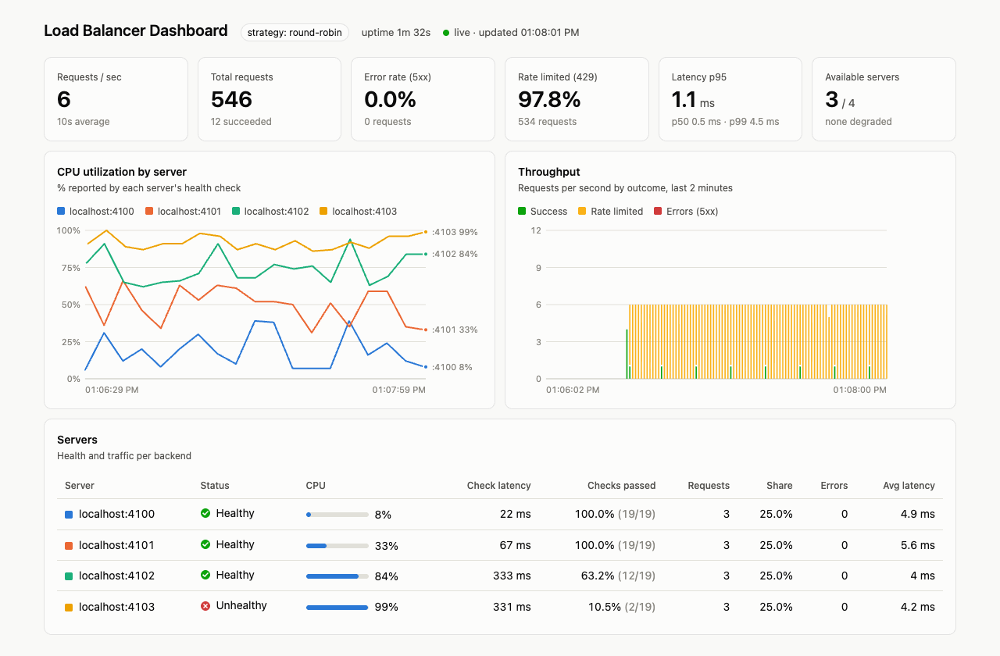
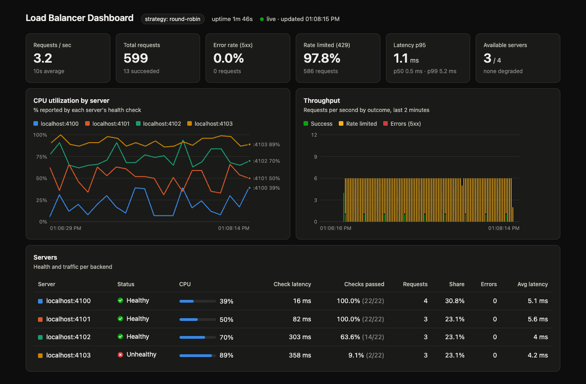

# Passerelle API intelligente avec Express.js

[](https://github.com/agogte/Smart-Api-Gateway/actions/workflows/ci.yml)


[🇬🇧 English](readme.md) | 🇫🇷 Français

Ce projet présente un répartiteur de charge simple écrit avec Node.js et Express. Il distribue les requêtes entrantes vers plusieurs serveurs backend selon cinq stratégies : round-robin, aléatoire, anneau de hachage cohérent, basée sur la santé, ou basée sur l'utilisation CPU. Il vérifie activement la santé de chaque backend, et les serveurs de test fournis simulent différents niveaux de disponibilité ainsi qu'une charge CPU aléatoire. Il inclut aussi un limiteur de débit avec deux algorithmes au choix (fenêtre glissante et seau à jetons), ainsi qu'un tableau de bord en direct qui affiche la santé des serveurs, l'utilisation CPU, le débit et la latence.




---

## Structure du projet

- `Api.js` : serveur principal du répartiteur. Relaie (proxy) les requêtes vers les backends selon un algorithme de répartition et applique la limitation de débit.
- `server.js` : lance plusieurs serveurs backend pour les tests.
- `loadbalancing-algorithms.js` : contient la classe `LoadBalancerBuilder` et l'énumération `LoadBalancerAlgorithm`.
- `rate-limiter.js` : middleware de limitation de débit en mémoire (fenêtre glissante et seau à jetons).
- `health-checker.js` : classe `HealthChecker` qui interroge périodiquement l'endpoint `/health` de chaque backend et suit son état, son utilisation CPU et sa latence.
- `config.js` : ports, nombre de serveurs, intervalle et délai d'expiration des contrôles de santé.
- `metrics.js` : `MetricsCollector`, qui enregistre le nombre de requêtes, leur résultat, le trafic par serveur et la latence pour le tableau de bord.
- `dashboard/index.html` : le tableau de bord en direct, servi par le répartiteur sur `/dashboard`.
- `load-test.js` : envoie un flux régulier de requêtes pour alimenter le tableau de bord.
- `test/` : tests unitaires et d'intégration, exécutés avec le lanceur de tests intégré à Node.
- `.github/workflows/ci.yml` : workflow GitHub Actions qui lance les tests à chaque pull request.

---

## Démarrage

### Prérequis

- Node.js v20+

### Installation

Installez les dépendances (`express` et `http-proxy`) :

```bash
npm install
```

---

## Utilisation

### 1. Lancer les serveurs backend

```bash
node server.js <startPort> <serverCount>
```

- `startPort` : premier numéro de port (par défaut : `3000`)
- `serverCount` : nombre de serveurs à lancer (par défaut : `1`)

Exemple :

```bash
node server.js 3000 3
```

Cela démarre des serveurs sur les ports 3000, 3001 et 3002. Chaque serveur reçoit un profil de disponibilité (voir [Santé simulée des serveurs](#santé-simulée-des-serveurs)).

### 2. Lancer le répartiteur de charge

```bash
node Api.js <startPort> <serverCount>
```

- `startPort` : doit correspondre au `startPort` utilisé pour les serveurs (par défaut : `4012`)
- `serverCount` : doit correspondre au nombre de serveurs lancés (par défaut : `3`)

Exemple :

```bash
node Api.js 3000 3
```

Les requêtes entrantes seront relayées vers les serveurs des ports 3000, 3001 et 3002.

### 3. Envoyer des requêtes

Ouvrez votre navigateur à l'adresse :

```
http://localhost:5001
```

La requête est routée vers l'un des backends avec la stratégie **round-robin** par défaut.

Pour voir ce que le répartiteur sait actuellement de chaque backend :

```
http://localhost:5001/lb/health
```

### 4. Ouvrir le tableau de bord

```
http://localhost:5001/dashboard
```

Pour générer du trafic, lancez le test de charge dans un autre terminal :

```bash
node load-test.js <requestsPerSecond> <seconds>
```

Exemple :

```bash
node load-test.js 8 120
```

---

## Fonctionnalités

### Stratégies de répartition de charge

Le répartiteur se configure avec la classe `LoadBalancerBuilder` et l'énumération `LoadBalancerAlgorithm`.

- **Round Robin (par défaut) :**  
  Parcourt la liste des serveurs l'un après l'autre à chaque requête.

- **Aléatoire (Random) :**  
  Choisit un serveur au hasard à chaque requête.

- **Hachage cohérent (Consistent Hash) :**  
  Place l'IP du client sur un anneau de hachage et la route vers le serveur qui possède le point le plus proche sur l'anneau. Chaque serveur occupe 100 nœuds virtuels pour équilibrer la distribution. Une même IP arrive toujours sur le même serveur tant que la liste des serveurs ne change pas, ce qui permet un routage « collant » (cache en mémoire, affinité de session) sans magasin de sessions.

- **Basée sur la santé (Health Based) :**  
  Ne route que vers les serveurs que le contrôleur de santé considère disponibles. Les serveurs `healthy` sont prioritaires ; les serveurs `degraded` ne servent qu'en l'absence de serveur sain. Les requêtes sont réparties en round-robin au sein du groupe choisi. Si tous les serveurs sont `unhealthy`, le répartiteur renvoie `503 Service Unavailable`.

- **Basée sur le CPU (CPU Based) :**  
  Route vers les serveurs disponibles avec une probabilité proportionnelle à leur marge CPU (`100 - cpu%`), d'après l'utilisation CPU remontée lors du dernier contrôle de santé. Un serveur à 10 % de CPU reçoit environ 9 fois plus de trafic qu'un serveur à 90 %. On utilise un tirage pondéré plutôt que « toujours le moins chargé » pour éviter que toutes les requêtes entre deux contrôles ne s'accumulent sur le même serveur.

Les stratégies Health Based et CPU Based nécessitent un contrôleur de santé, fourni via `setHealthChecker()`. `build()` lève une erreur s'il est absent.

Pour changer de stratégie, modifiez ces lignes dans `Api.js` :

```js
const {
  LoadBalancerBuilder,
  LoadBalancerAlgorithm,
} = require("./loadbalancing-algorithms");

const healthChecker = new HealthChecker(servers, {
  interval: healthCheckInterval,
  timeout: healthCheckTimeout,
}).start();

const loadbalancer = new LoadBalancerBuilder()
  .setServers(servers)
  .setHealthChecker(healthChecker)
  .setStrategy(LoadBalancerAlgorithm.ROUND_ROBIN) // ou RANDOM, CONSISTENT_HASH, HEALTH_BASED, CPU_BASED
  .setLogging(true)
  .build();

app.get(
  "/",
  rateLimiter(5, 60 * 1000, RateLimiterAlgorithm.TOKEN_BUCKET),
  loadbalancer,
);
```

### Contrôles de santé

`HealthChecker` interroge `GET <serveur>/health` sur chaque backend toutes les `healthCheckInterval` ms (`5000` par défaut, défini dans `config.js`). Chaque serveur se trouve dans l'un de ces états :

| État | Signification | Reçoit du trafic (stratégies santé/CPU) |
|------|---------------|------------------------------------------|
| `unknown` | Pas encore vérifié | Non |
| `healthy` | Le dernier contrôle a réussi et a renvoyé `healthy` | Oui |
| `degraded` | Le dernier contrôle a réussi mais a renvoyé `degraded` | Oui (Health Based : seulement en secours) |
| `unhealthy` | `unhealthyThreshold` échecs consécutifs (délai dépassé, erreur de connexion, code non-2xx ou `status: "unhealthy"`) | Non |

Pour éviter les oscillations, un serveur doit échouer `unhealthyThreshold` fois de suite pour être marqué hors service, et réussir `healthyThreshold` fois de suite pour revenir. Les changements d'état sont journalisés :

```
Health: http://localhost:3002 healthy → unhealthy (cpu: 91%)
```

Options :
| Option | Défaut | Description |
|--------|--------|-------------|
| `interval` | `5000` | Délai entre deux contrôles, en ms |
| `timeout` | `1000` | Un contrôle plus lent que cette valeur compte comme un échec |
| `path` | `/health` | Endpoint de santé sur chaque backend |
| `unhealthyThreshold` | `2` | Échecs consécutifs avant de marquer un serveur hors service |
| `healthyThreshold` | `2` | Succès consécutifs avant qu'un serveur hors service ne revienne |
| `logging` | `true` | Journaliser les changements d'état |

### Santé simulée des serveurs

`server.js` dote chaque backend d'un endpoint `/health` qui renvoie une utilisation CPU aléatoire et échoue selon un taux fixé par son profil de disponibilité. Les serveurs reçoivent les profils dans l'ordre (serveur 1 = high, serveur 2 = medium, serveur 3 = low, serveur 4 = down, serveur 5 = high, ...) :

| Profil | Taux de réussite | Probabilité de `degraded` | Plage CPU | Latence ajoutée |
|--------|------------------|---------------------------|-----------|-----------------|
| `high` | 99 % | 5 % | 5–40 % | 0–20 ms |
| `medium` | 90 % | 20 % | 30–70 % | 20–100 ms |
| `low` | 60 % | 40 % | 60–95 % | 100–400 ms |
| `down` | 10 % | 50 % | 85–100 % | 300–800 ms |

Exemple de réponse :

```json
{ "status": "degraded", "cpu": 64, "profile": "medium" }
```

Lancez au moins 4 serveurs pour voir tous les profils, puis passez `Api.js` en `HEALTH_BASED` ou `CPU_BASED` et observez le trafic se détourner des serveurs les plus faibles. Modifiez `AvailabilityProfile` dans `server.js` pour ajuster les valeurs.

### Tableau de bord

Le répartiteur sert un tableau de bord en direct sur `http://localhost:5001/dashboard`. Il interroge `/lb/metrics` chaque seconde et affiche :

- **Indicateurs clés :** requêtes par seconde (moyenne sur 10 s), nombre total de requêtes, taux d'erreur (5xx), part des requêtes limitées (429), latence p50/p95/p99, et nombre de serveurs disponibles (dont dégradés).
- **Utilisation CPU par serveur :** une courbe par serveur issue de l'historique des contrôles de santé (60 derniers contrôles), étiquetée sur le bord droit. Survolez pour voir les valeurs exactes.
- **Débit :** barres empilées par seconde sur les 2 dernières minutes, réparties en succès, requêtes limitées et erreurs.
- **Tableau des serveurs :** état, CPU actuel, latence du contrôle de santé, pourcentage de contrôles réussis, requêtes servies, part du trafic, erreurs et latence moyenne pour chaque backend.

Il suit le thème clair/sombre du système. Ajoutez `?theme=dark` ou `?theme=light` à l'URL pour le forcer.

| Clair | Sombre |
|-------|--------|
|  |  |

La latence est mesurée de bout en bout au niveau du répartiteur : les requêtes limitées (répondues sans contacter de backend) sont donc incluses. Les données brutes sont disponibles en JSON sur `http://localhost:5001/lb/metrics`. Toutes les métriques sont en mémoire et remises à zéro au redémarrage du répartiteur.

### Limitation de débit

Chaque IP cliente est limitée à un nombre configurable de requêtes par fenêtre de temps. Au-delà, le serveur renvoie `429 Too Many Requests` avec une valeur `retryAfter`.

Deux algorithmes sont disponibles via `RateLimiterAlgorithm` :

- **Fenêtre glissante (Sliding Window, par défaut) :**  
  Enregistre l'horodatage exact des requêtes récentes dans une fenêtre mobile. Une requête est rejetée si le nombre de requêtes des `windowSize` dernières ms atteint ou dépasse `rateLimit`.

- **Seau à jetons (Token Bucket) :**  
  Chaque IP dispose d'un seau qui démarre plein (`rateLimit` jetons) et se remplit en continu au rythme de `rateLimit / windowSize` jetons par ms. Chaque requête consomme un jeton. Les requêtes sont rejetées quand le seau est vide, et le client est informé du délai avant qu'un jeton soit de nouveau disponible. Cela autorise de courtes rafales jusqu'à la capacité du seau tout en lissant le trafic soutenu.

Pour changer d'algorithme, modifiez l'appel à `rateLimiter` dans `Api.js` :

```js
const { rateLimiter, RateLimiterAlgorithm } = require("./rate-limiter");

// Fenêtre glissante (par défaut)
app.get(
  "/",
  rateLimiter(5, 60 * 1000, RateLimiterAlgorithm.SLIDING_WINDOW),
  loadbalancer,
);

// Seau à jetons
app.get(
  "/",
  rateLimiter(5, 60 * 1000, RateLimiterAlgorithm.TOKEN_BUCKET),
  loadbalancer,
);
```

Paramètres :
| Paramètre | Défaut | Description |
|-----------|--------|-------------|
| `rateLimit` | `5` | Nombre maximal de requêtes (ou capacité du seau pour le seau à jetons) |
| `windowSize` | `60000` | Fenêtre de temps en ms |
| `algorithm` | `SLIDING_WINDOW` | `RateLimiterAlgorithm.SLIDING_WINDOW` ou `TOKEN_BUCKET` |

---

## Tests et CI

Lancez les tests avec :

```bash
npm test
```

Les tests utilisent le lanceur intégré `node:test`, sans dépendance de développement supplémentaire. Ils démarrent de vrais backends sur des ports aléatoires et couvrent :

- **Limiteur de débit :** les deux algorithmes acceptent jusqu'à la limite, suivent chaque IP séparément et se rétablissent avec le temps.
- **Contrôleur de santé :** lecture des états healthy/degraded, seuils de panne et de rétablissement, délais dépassés, connexions refusées, historique.
- **Répartition de charge :** toutes les stratégies, dont le repli sur les serveurs dégradés et le `503` pour Health Based, la pondération par marge CPU pour CPU Based, et le `502` quand un backend est injoignable.
- **Métriques :** comptage par résultat, attribution par serveur, percentiles de latence et série temporelle par seconde.

GitHub Actions ([`ci.yml`](.github/workflows/ci.yml)) s'exécute à chaque pull request et à chaque push sur `master`, sous Node 20 et 22. Après les tests unitaires, il démarre 4 serveurs et le répartiteur, puis vérifie que `/`, `/dashboard` et `/lb/metrics` répondent.

---

## Arrêt propre

Appuyez sur `0` dans le terminal du répartiteur ou d'un serveur backend pour l'arrêter proprement.

---

## Licence

Ce projet est uniquement destiné à un usage pédagogique.
