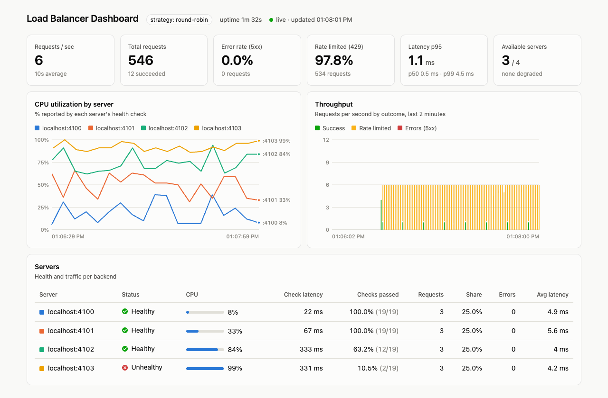
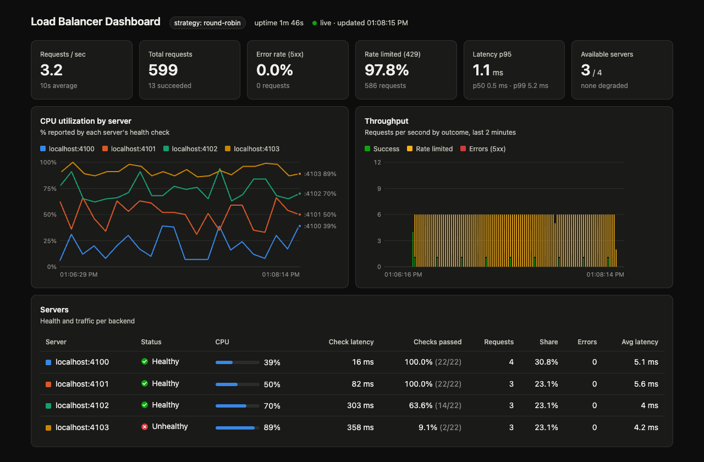

# Smart API Gateway with Express.js

[](https://github.com/agogte/Smart-Api-Gateway/actions/workflows/ci.yml)


🇬🇧 English | [🇫🇷 Français](readme.fr.md)

This project demonstrates a simple load balancer implemented using Node.js and Express. The load balancer distributes incoming requests to multiple backend servers using round-robin, random, consistent hash ring, health-based, or CPU-utilization-based selection strategies. It actively health-checks every backend, and the bundled test servers simulate different levels of availability and random CPU load. It also includes a rate limiter with two algorithm options: sliding window and token bucket, and a live dashboard showing server health, CPU utilization, throughput and latency.




---

## Project Structure

- `Api.js`: Main load balancer server. Proxies requests to backend servers using a load balancing algorithm and applies rate limiting.
- `server.js`: Spawns multiple backend servers for testing.
- `loadbalancing-algorithms.js`: Contains the `LoadBalancerBuilder` class and `LoadBalancerAlgorithm` enum for flexible load balancing.
- `rate-limiter.js`: Implements in-memory rate limiting middleware with sliding window and token bucket algorithms.
- `health-checker.js`: `HealthChecker` class that periodically polls each backend's `/health` endpoint and tracks its status, CPU utilization and latency.
- `config.js`: Ports, server count and health check interval/timeout.
- `metrics.js`: `MetricsCollector` that records request counts, outcomes, per-server traffic and latency for the dashboard.
- `dashboard/index.html`: The live dashboard, served by the load balancer at `/dashboard`.
- `load-test.js`: Sends a steady stream of requests so the dashboard has something to show.
- `test/`: Unit and integration tests, run with Node's built-in test runner.
- `.github/workflows/ci.yml`: GitHub Actions workflow that runs the tests on every pull request.

---

## Getting Started

### Prerequisites

- Node.js v20+

### Installation

Install the dependencies (`express` and `http-proxy`):

```bash
npm install
```

---

## Usage

### 1. Start the Backend Servers

```bash
node server.js <startPort> <serverCount>
```

- `startPort`: Starting port number (default: `3000`)
- `serverCount`: Number of servers to spin up (default: `1`)

Example:

```bash
node server.js 3000 3
```

This will start servers on ports 3000, 3001, and 3002. Each server is assigned an availability profile (see [Simulated Server Health](#simulated-server-health)).

### 2. Start the Load Balancer

```bash
node Api.js <startPort> <serverCount>
```

- `startPort`: Must match the `startPort` used when starting the servers (default: `4012`)
- `serverCount`: Must match the number of servers you started (default: `3`)

Example:

```bash
node Api.js 3000 3
```

This will proxy incoming requests to servers on ports 3000, 3001, and 3002.

### 3. Send Requests

Open your browser and navigate to:

```
http://localhost:5001
```

This will route the request to one of the backend servers using the **round-robin** strategy by default.

To see what the load balancer currently knows about each backend:

```
http://localhost:5001/lb/health
```

### 4. Open the Dashboard

```
http://localhost:5001/dashboard
```

To generate traffic, run the load test in another terminal:

```bash
node load-test.js <requestsPerSecond> <seconds>
```

Example:

```bash
node load-test.js 8 120
```

---

## Features

### Load Balancing Strategies

The load balancer uses the `LoadBalancerBuilder` class and `LoadBalancerAlgorithm` enum to configure its behavior.

- **Round Robin (Default):**  
  Cycles through the list of servers sequentially for each request.

- **Random:**  
  Selects a server randomly for each request.

- **Consistent Hash:**  
  Hashes the client IP onto a hash ring and routes it to the server owning the nearest point on the ring. Each server is placed at 100 virtual node positions to keep the distribution even. The same client IP always maps to the same server as long as the server list doesn't change, which makes this useful for sticky routing (e.g. in-memory caches or session affinity) without needing a session store.

- **Health Based:**  
  Routes only to servers the health checker considers available. `healthy` servers are preferred; `degraded` servers are used only when no healthy server is left. Requests are round-robined within the chosen tier. If every server is `unhealthy`, the load balancer returns `503 Service Unavailable`.

- **CPU Based:**  
  Routes to available servers with probability proportional to their CPU headroom (`100 - cpu%`), using the CPU utilization each server reports in its last health check. A server at 10% CPU gets roughly 9× the traffic of one at 90%. Weighted selection is used instead of "always pick the lowest" so that every request between two health checks doesn't pile onto the same server.

Health Based and CPU Based need a health checker, passed in with `setHealthChecker()`. `build()` throws if it's missing.

To switch strategies, update the following lines in `Api.js`:

```js
const {
  LoadBalancerBuilder,
  LoadBalancerAlgorithm,
} = require("./loadbalancing-algorithms");

const healthChecker = new HealthChecker(servers, {
  interval: healthCheckInterval,
  timeout: healthCheckTimeout,
}).start();

const loadbalancer = new LoadBalancerBuilder()
  .setServers(servers)
  .setHealthChecker(healthChecker)
  .setStrategy(LoadBalancerAlgorithm.ROUND_ROBIN) // or RANDOM, CONSISTENT_HASH, HEALTH_BASED, CPU_BASED
  .setLogging(true)
  .build();

app.get(
  "/",
  rateLimiter(5, 60 * 1000, RateLimiterAlgorithm.TOKEN_BUCKET),
  loadbalancer,
);
```

### Health Checks

`HealthChecker` polls `GET <server>/health` on every backend every `healthCheckInterval` ms (default `5000`, set in `config.js`). Each server ends up in one of these states:

| Status | Meaning | Receives traffic (health/CPU strategies) |
|--------|---------|------------------------------------------|
| `unknown` | Not checked yet | No |
| `healthy` | Last check succeeded and reported `healthy` | Yes |
| `degraded` | Last check succeeded but reported `degraded` | Yes (Health Based: only as fallback) |
| `unhealthy` | Failed `unhealthyThreshold` checks in a row (timeout, connection error, non-2xx, or `status: "unhealthy"`) | No |

To avoid flapping, a server needs `unhealthyThreshold` consecutive failures to be marked unhealthy, and `healthyThreshold` consecutive successes to come back. Status changes are logged:

```
Health: http://localhost:3002 healthy → unhealthy (cpu: 91%)
```

Options:
| Option | Default | Description |
|--------|---------|-------------|
| `interval` | `5000` | Time between checks in ms |
| `timeout` | `1000` | A check slower than this counts as a failure |
| `path` | `/health` | Health endpoint on each backend |
| `unhealthyThreshold` | `2` | Consecutive failures before marking unhealthy |
| `healthyThreshold` | `2` | Consecutive successes before an unhealthy server rejoins |
| `logging` | `true` | Log status transitions |

### Simulated Server Health

`server.js` gives each backend a `/health` endpoint that returns a random CPU utilization and fails at a rate set by its availability profile. Servers cycle through the profiles in order (server 1 = high, server 2 = medium, server 3 = low, server 4 = down, server 5 = high, ...):

| Profile | Check success rate | Chance of `degraded` | CPU range | Added latency |
|---------|-------------------|----------------------|-----------|---------------|
| `high` | 99% | 5% | 5–40% | 0–20 ms |
| `medium` | 90% | 20% | 30–70% | 20–100 ms |
| `low` | 60% | 40% | 60–95% | 100–400 ms |
| `down` | 10% | 50% | 85–100% | 300–800 ms |

Example response:

```json
{ "status": "degraded", "cpu": 64, "profile": "medium" }
```

Start 4 or more servers to see all profiles, then switch `Api.js` to `HEALTH_BASED` or `CPU_BASED` and watch traffic shift away from the weaker servers. Edit `AvailabilityProfile` in `server.js` to change the numbers.

### Dashboard

The load balancer serves a live dashboard at `http://localhost:5001/dashboard`. It polls `/lb/metrics` every second and shows:

- **Key metrics:** requests per second (10s average), total requests, error rate (5xx), share of requests rate limited (429), latency p50/p95/p99, and how many servers are available (and how many are degraded).
- **CPU utilization by server:** a line per server from its health check history (last 60 checks), labeled at the right edge. Hover for exact values.
- **Throughput:** stacked bars per second for the last 2 minutes, split into success, rate limited and errors.
- **Servers table:** status, current CPU, health check latency, percentage of health checks passed, requests served, share of traffic, errors and average latency for every backend.

It follows your OS light/dark setting. Add `?theme=dark` or `?theme=light` to the URL to override it.

| Light | Dark |
|-------|------|
|  |  |

Latency is measured end to end at the load balancer, so rate-limited requests (answered without touching a backend) are included. The raw data is available as JSON at `http://localhost:5001/lb/metrics`. All metrics are in memory and reset when the load balancer restarts.

### Rate Limiting

Each client IP is limited to a configurable number of requests per time window. Exceeding the limit returns a `429 Too Many Requests` response with a `retryAfter` value.

Two algorithms are available via `RateLimiterAlgorithm`:

- **Sliding Window (default):**  
  Tracks the exact timestamps of recent requests in a rolling window. A request is rejected if the number of requests in the last `windowSize` ms is at or above `rateLimit`.

- **Token Bucket:**  
  Each IP gets a bucket that starts full (`rateLimit` tokens) and refills continuously at a rate of `rateLimit / windowSize` tokens per ms. Each request consumes one token. Requests are rejected when the bucket is empty, and clients are told how long to wait until a token is available again. This allows short bursts up to the bucket capacity while smoothing out sustained traffic.

To switch algorithms, update the `rateLimiter` call in `Api.js`:

```js
const { rateLimiter, RateLimiterAlgorithm } = require("./rate-limiter");

// Sliding window (default)
app.get(
  "/",
  rateLimiter(5, 60 * 1000, RateLimiterAlgorithm.SLIDING_WINDOW),
  loadbalancer,
);

// Token bucket
app.get(
  "/",
  rateLimiter(5, 60 * 1000, RateLimiterAlgorithm.TOKEN_BUCKET),
  loadbalancer,
);
```

Parameters:
| Parameter | Default | Description |
|-----------|---------|-------------|
| `rateLimit` | `5` | Max requests (or bucket capacity for token bucket) |
| `windowSize` | `60000` | Time window in ms |
| `algorithm` | `SLIDING_WINDOW` | `RateLimiterAlgorithm.SLIDING_WINDOW` or `TOKEN_BUCKET` |

---

## Tests and CI

Run the test suite with:

```bash
npm test
```

The tests use Node's built-in `node:test` runner, so there are no extra dev dependencies. They start real backends on random ports and cover:

- **Rate limiter:** both algorithms allow up to the limit, track IPs separately, and recover over time.
- **Health checker:** healthy/degraded parsing, failure and recovery thresholds, timeouts, refused connections, history.
- **Load balancing:** every strategy, including degraded fallback and `503` for health-based, headroom weighting for CPU-based, and `502` when a backend is unreachable.
- **Metrics:** outcome counts, per-server attribution, latency percentiles and the per-second timeseries.

GitHub Actions ([`ci.yml`](.github/workflows/ci.yml)) runs on every pull request and on pushes to `master`, on Node 20 and 22. After the unit tests it starts 4 servers and the load balancer and checks that `/`, `/dashboard` and `/lb/metrics` respond.

---

## Graceful Shutdown

Press `0` in the terminal running either the load balancer or any backend server to stop it gracefully.

---

## License

This project is for educational purposes only.
